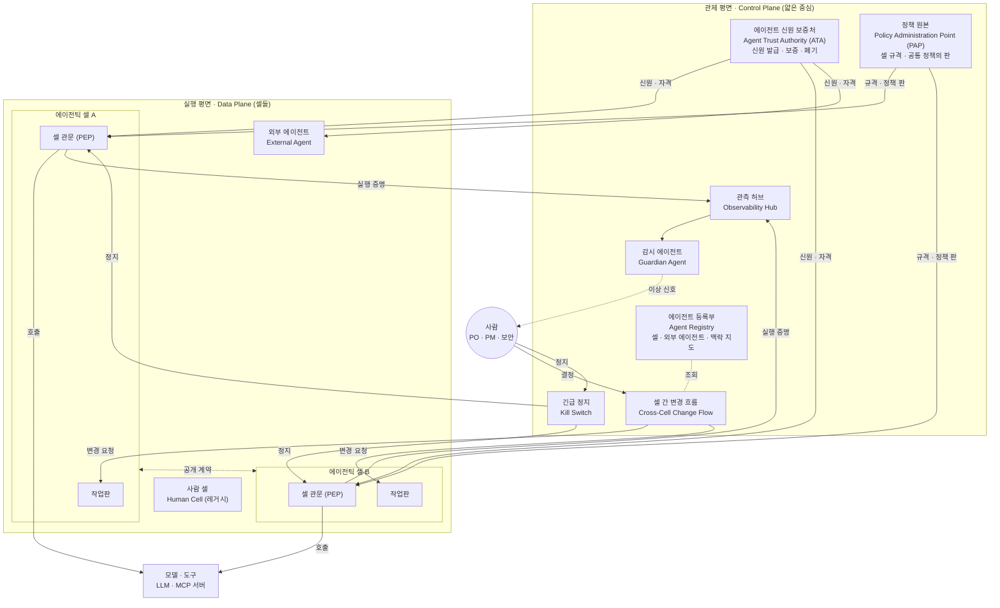
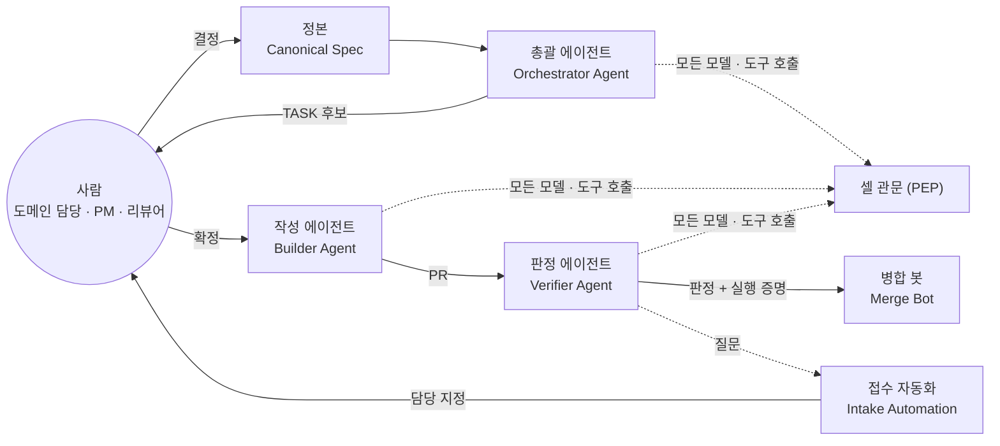

# AI 에이전틱 컨셉추얼 아키텍처 (초안 1)
<!-- 배포 전 작업본. 내부 개정 기록은 AI_에이전틱_검토로그.md에만 둔다. -->

> 이 문서는 에이전틱 체계의 **가장 바깥 그림**이다. 무엇이 있고, 각각 무슨 일을 하며, 일이 어떻게 흐르는지만 적는다. 세부는 아래 줌인 단계(6절)로 내려가며 정한다.
> 바탕 문서: `AI_에이전틱_오케스트레이션_설계.md`(셀 하나의 설계 · 상위 층), 핵심규약(셀 안 규칙). 바탕 대화: white 11-14 토론(셀과 상위 층, 오토스케일, 얇은 중심, 프로토콜 방식, DNS 비유).
> 신뢰 표기: 표준 용어의 출처는 조회하지 않은 학습 지식이라 (신뢰 3~4·학습 지식)으로 적는다.

## 1. 한 장 요약

- 시스템마다 **에이전틱 셀**이 하나씩 있고, 셀이 실제 일을 한다(실행 평면).
- 셀들은 **셀 규격**이라는 하나의 프로토콜을 따른다. 그래서 중앙이 일일이 시키지 않아도 같은 규칙이 지켜진다(집행과 검증은 분산).
- 위에는 **얇은 중심**(관제 평면)만 둔다. 중심이 하는 일은 셋뿐이다. 신원의 뿌리, 규격과 정책의 원본, 긴급 정지. 그리고 셀을 찾게 해 주는 등록부와, 여러 셀에 걸친 변경의 흐름을 조정한다.
- AI는 셀 안에서도 중심에서도 **보조**다. 결정과 책임은 사람이다.

## 2. 아키텍처 그림

### 2-1. 전체 (C4 1단계: 시스템 맥락)

- 실선은 일이 흐르는 길, 점선은 조회 · 알림이다.
- 관제 평면의 부품은 모두 **일이 지나가는 길 밖**에 있다. 모델 · 도구 호출은 셀 관문에서 바로 나가고, 중심을 거치지 않는다.

### 2-2. 셀 안 (C4 3단계 미리 보기)

## 3. 용어 정의

구분: **표준** = 이미 있는 용어를 그 뜻으로 씀 · **차용** = 있는 용어를 우리 맥락에 맞게 좁혀 씀 · **명명** = 맞는 용어가 없어 새로 지음.

### 3-1. 큰 구분

| 영문 | 약어 | 한글 업무 용어 | 구분 | 정의 |
| :--- | :--- | :--- | :---: | :--- |
| Agentic Cell | 셀 | 에이전틱 셀 | 차용 | 시스템 하나에 들어가는 실행 단위. 정본 하나 · 작업판 하나 · 앱 저장소 여럿 · 에이전트 다섯 · 관문. 한 셀의 문제가 다른 셀로 번지지 않게 나눈다(클라우드 '셀 기반 아키텍처'에서 차용, 신뢰 3·학습 지식) |
| Data Plane | — | 실행 평면 | 표준 | 실제 일이 일어나는 층. 여기서는 셀들 |
| Control Plane | — | 관제 평면 | 표준 | 실행 평면을 관리하는 층. 여기서는 얇은 중심 |
| Cell Conformance Spec | CCS | 셀 규격 | 명명 | 모든 셀이 지키는 프로토콜. 이것을 지키면 셀 안이 달라도 관제 평면에 붙는다. 여섯 항목(5절) |
| Federation Level | — | 연합 단 | 차용 | 관제 평면을 겹쳐 쓸 때의 한 단(시스템 → 사업 단위 → 사내). 지금은 한 단만 쓴다 |

### 3-2. 관제 평면의 부품

| 영문 | 약어 | 한글 업무 용어 | 구분 | 정의 |
| :--- | :--- | :--- | :---: | :--- |
| Agent Trust Authority | ATA | 에이전트 신원 보증처 | 명명 | 에이전트마다 신원과 짧게 사는 자격을 발급 · 보증하고, 탈취되거나 퇴역한 신원을 폐기한다. 신뢰의 뿌리(Trust Anchor, 표준)다. 인증서 발급처(CA)와 같은 자리. white 제안 'ACS'는 인증만 담아, 발급 · 보증 · 폐기를 함께 담는 이름으로 넓혔다(대안: Agent Credential Service, ACS) |
| Trust Anchor | — | 신뢰의 뿌리 | 표준 | 모든 신원 확인이 거슬러 올라가는 출발점. ATA가 갖는다 |
| Policy Administration Point | PAP | 정책 원본 | 표준 | 공통 정책과 셀 규격의 원본과 판을 관리하는 곳(NIST SP 800-207 제로 트러스트 용어, 신뢰 4·학습 지식). 이 저장소(규약 원본)가 그 원본이다 |
| Agent Registry | — | 에이전트 등록부 | 표준 | 셀 · 외부 에이전트 · 도구의 목록, 주인, 판, 공개 계약, 셀 사이 관계. 조회만 받고 일의 길에 끼지 않는다. DNS와 같은 자리 |
| Context Map | — | 맥락 지도 | 표준 | 셀(경계) 사이 관계와 공개 계약을 그린 지도(DDD 용어, 신뢰 4). 등록부 안에 있다 |
| Kill Switch | — | 긴급 정지 | 표준 | 셀 · 에이전트 · 신원 단위로 즉시 멈춤. 사람이 누르거나, 정해진 문턱이면 셀 관문이 기계로 멈춘다 |
| Cross-Cell Change Flow | CCF | 셀 간 변경 흐름 | 명명 | 여러 셀에 걸친 변경만 타는 흐름. 상위 변경을 셀별 변경 요청으로 쪼개고, 계약 검사 · 배포 순서를 조정한다 |
| Cross-Cell Change Request | CCR | 상위 변경 | 명명 | 여러 셀에 걸친 결정 하나의 기록. 책임자는 그 결정을 내린 사람 |
| Observability Hub | — | 관측 허브 | 차용 | 셀들이 보낸 실행 증명과 관문 기록을 모아 보는 곳. 읽기만 한다 |
| Guardian Agent | — | 감시 에이전트 | 표준 | 다른 AI를 감시하는 AI(Gartner 용어, 신뢰 4). 기록을 보고 이상 신호를 사람에게 알린다. 고치거나 멈추지 않는다 |

### 3-3. 셀의 부품

| 영문 | 약어 | 한글 업무 용어 | 구분 | 정의 |
| :--- | :--- | :--- | :---: | :--- |
| Policy Enforcement Point | PEP | 셀 관문 | 표준 | 셀의 모든 모델 · 도구 호출이 지나가며 정책을 집행하는 곳(NIST SP 800-207 용어). 셀마다 하나씩 두는 분산 집행. 'Agent Gateway'(업계 용어)와 같다 |
| Policy Decision Point | PDP | 정책 판단 | 표준 | 호출 하나를 허용할지 판단하는 부분. 셀 관문 안에 둔다(정책은 PAP에서 받음) |
| Work Board | — | 작업판 | 명명 | 셀의 상태 원본. 조건 셋: 상태와 기록이 남음 · 상태가 바뀌면 신호 · 확정에 권한. 기준 구현은 GitHub |
| Canonical Spec | — | 정본 | 차용 | 셀의 업무 규칙 원본(핵심규약 1절) |
| Orchestrator Agent | — | 총괄 에이전트 | 표준 | 변경을 작업 후보로 쪼개고 배정 후보를 붙인다. 확정은 사람 |
| Builder Agent | — | 작성 에이전트 | 차용 | 작업을 맡아 산출물을 만든다. 셀 안의 유일한 쓰기 주체 |
| Verifier Agent | — | 판정 에이전트 | 표준 | 만든 것을 기준과 대조한다(생성자-검증자 패턴의 검증자, 신뢰 4). 고치지 않는다 |
| Merge Bot | — | 병합 봇 | 차용 | 관문 수준이 허락할 때 확정(병합)만 실행하는 스크립트. AI가 아니다 |
| Intake Automation | — | 접수 자동화 | 명명 | 질문 · 요청을 받아 담당자를 붙인다. AI가 아니다 |
| Gate Autonomy Level | — | 관문 수준 | 명명 | 판정 관문에서 AI 판정의 효력. 3 사람 판정 / 2 AI 판정 + 사람 확인 / 1 AI 판정 통과 · 사후 되돌림 |
| Run Attestation | — | 실행 증명 | 차용 | 에이전트 실행마다 남기는 서명된 기록(수행자 · 모델 · 지침 판 · 대조 커밋 · 토큰 · 판정). 받는 쪽이 중심에 묻지 않고 직접 확인한다(소프트웨어 공급망의 빌드 증명에서 차용, 신뢰 3) |

### 3-4. 셀 사이

| 영문 | 약어 | 한글 업무 용어 | 구분 | 정의 |
| :--- | :--- | :--- | :---: | :--- |
| Published Contract | — | 공개 계약 | 차용 | 셀이 다른 셀에 내보이는 API · 이벤트 · 데이터의 약속. 주인 셀은 하나(DDD의 공개 언어 Published Language에서 차용) |
| Consumer-Driven Contract Test | CDC | 소비자 주도 계약 테스트 | 표준 | 받는 셀이 기대를 테스트로 적고, 내보내는 셀이 통과해야 한다. 셀 사이 검사를 기계로 한다 |
| Expand–Contract | — | 넓히고 좁히기 배포 | 표준 | 계약을 바꿀 때 옛 · 새 형식을 함께 받는 판을 먼저 내고, 모두 옮긴 뒤 옛 형식을 지운다 |
| Human Cell | — | 사람 셀 | 명명 | 셀 규격을 못 채우는 시스템(레거시 · 외부 솔루션). 사람이 상태를 옮기고, 걸린 관문은 수준 3 |
| External Agent | — | 외부 에이전트 | 명명 | 우리가 만들지 않은 에이전트(타사 제품 등). 등록과 관문 경유만 지킨다 |
| Lowest Common Level | — | 가장 낮은 공통 단 | 명명 | 셀 간 변경을 처리하는 단. 걸린 셀들을 모두 덮는 가장 낮은 단 하나에서만 처리한다 |

## 4. 부위별 역할

1. **에이전트 신원 보증처(ATA)**: 에이전트가 태어날 때 신원을 주고, 일할 때마다 짧게 사는 자격을 준다. 문제가 생기면 그 신원을 폐기 목록에 올려 모든 셀 관문이 곧바로 거절하게 한다. 사람 계정과 섞지 않는다.
2. **정책 원본(PAP)**: 셀 규격, 공통 정책(허용 모델 · 도구, 데이터 등급, 비용 한도의 상한), 핵심규약과 스킬의 판을 둔다. 판을 올리면 셀마다 PR 하나로 내려가고 셀 담당자가 병합한다. 셀은 더 엄하게만 바꿀 수 있다.
3. **에이전트 등록부**: 무엇이 있고 누가 주인인지, 어떤 공개 계약으로 이어지는지 답한다. 셀 간 변경 흐름이 '이 변경이 어느 셀에 걸리나'를 찾을 때 쓴다.
4. **긴급 정지**: 사람이 셀 · 에이전트 · 신원 단위로 누른다. 비용 한도 같은 정해진 문턱은 셀 관문이 기계로 먼저 멈춘다.
5. **셀 간 변경 흐름(CCF)**: 걸친 변경만 탄다. 쪼개기는 AI가 후보를 내고 사람이 판정하며(수준 3 고정), 셀마다 각자의 흐름으로 처리한 뒤 계약 테스트와 넓히고 좁히기 순서로 맞춘다.
6. **관측 허브와 감시 에이전트**: 셀이 보낸 실행 증명과 관문 기록을 모아, 비용 급증 · 판정 뒤집힘 · 실패 반복 · 권한 밖 호출 시도를 찾아 사람에게 알린다. 관문 수준을 올리고 내릴 근거가 된다.
7. **셀 관문(PEP)**: 셀 안의 에이전트가 모델 · 도구를 부를 때마다 신원 확인(ATA), 정책 판단(PDP), 데이터 등급 차단, 비용 계산, 감사 기록을 한다. 셀마다 있어서 중심 하나가 멈춰도 다른 셀은 돈다.
8. **작업판 · 정본 · 셀 안 에이전트**: 오케스트레이션 설계 1~10절 그대로다.

## 5. 셀 규격(CCS) 여섯 항목

| # | 항목 | 왜 필요한가 |
| :---: | :--- | :--- |
| 1 | 등록부에 한 줄(이름 · 시스템 · 주인 · 작업판 · 규격 판 · 켠 선택 항목) | 찾을 수 있어야 이을 수 있다 |
| 2 | 작업판 세 조건 | 상태로 돌기 위해 |
| 3 | 실행 증명 형식 | 중심에 묻지 않고 서로 확인하기 위해 |
| 4 | 모든 모델 · 도구 호출은 셀 관문으로, 신원은 ATA에서 | 가드레일을 에이전트 바깥에서 집행하기 위해 |
| 5 | 공개 계약과 받는 쪽 계약 테스트 | 셀 사이 검사를 기계로 하기 위해 |
| 6 | 관문 수준 · 위험 등급 A 설정 형식 | 셀마다 다른 수준을 같은 눈으로 보기 위해 |

## 6. 흐름 넷

1. **셀 안의 일(대부분)**: 정본 결정 → 총괄의 작업 후보 → 사람 확정 → 작성 → 판정 → 관문 수준대로 병합. 관제 평면에 올라가지 않는다. 모델 호출만 셀 관문을 지나며, 실행 증명이 관측 허브로 간다.
2. **셀 간 변경(드묾)**: 사람이 상위 변경(CCR)을 연다 → 등록부로 걸린 셀을 찾고, 가장 낮은 공통 단에서 처리 → 쪼개기 후보 → 사람 판정 → 셀마다 변경 요청 → 각 셀 흐름 → 계약 테스트 → 넓히고 좁히기 순서로 배포. 하위 호환 변경은 이 흐름을 타지 않고 그 셀 혼자 끝낸다.
3. **감시와 정지**: 실행 증명 · 관문 기록 → 관측 허브 → 감시 에이전트가 이상 신호 → 사람이 판단 → 필요하면 긴급 정지. 문턱을 넘는 것은 셀 관문이 기계로 먼저 멈춘다.
4. **규격 판 올림**: 정책 원본에서 판을 올림 → 셀마다 PR → 셀 담당자 병합 → 등록부의 그 셀 줄에 규격 판 갱신.

## 7. 줌인 단계 (C4 모델을 따름)

| 단계 | C4 이름 | 이 체계에서 | 문서 |
| :---: | :--- | :--- | :--- |
| 1 | 시스템 맥락(System Context) | 이 문서 2-1 그림: 셀들 · 관제 평면 · 사람 · 모델 | 이 문서 |
| 2 | 컨테이너(Container) | 관제 평면 부품 일곱과 셀 관문 · 작업판 각각의 책임 · 주고받는 것 · 저장 위치 | 다음 문서(논리 아키텍처) |
| 3 | 구성 요소(Component) | 셀 안 에이전트 다섯 · 관문 · 판정 흐름 | `AI_에이전틱_오케스트레이션_설계.md` 1~10절 |
| 4 | 코드(Code) | 워크플로 · 설정 · 스크립트 · 스킬 | 설치서 · `skills/` · 다음 층 초안 |

C4 모델은 소프트웨어 아키텍처를 네 단계 확대로 그리는 방식이다(신뢰 3·학습 지식). 지금 3 · 4단계의 일부는 이미 있고, 2단계(논리 아키텍처)가 비어 있다. 다음 작업은 2단계다.

## 8. 남은 결정

1. **(white님)** 이름 둘: 신원 보증처를 ATA(Agent Trust Authority)로 할지 ACS(Agent Credential Service)로 할지, 셀 규격을 CCS(Cell Conformance Spec)로 할지.
2. **(다음 단계)** 관문 · 신원 보증처 · 관측 허브를 업체 제품으로 쓸지 만들지(셀 시범 뒤).
