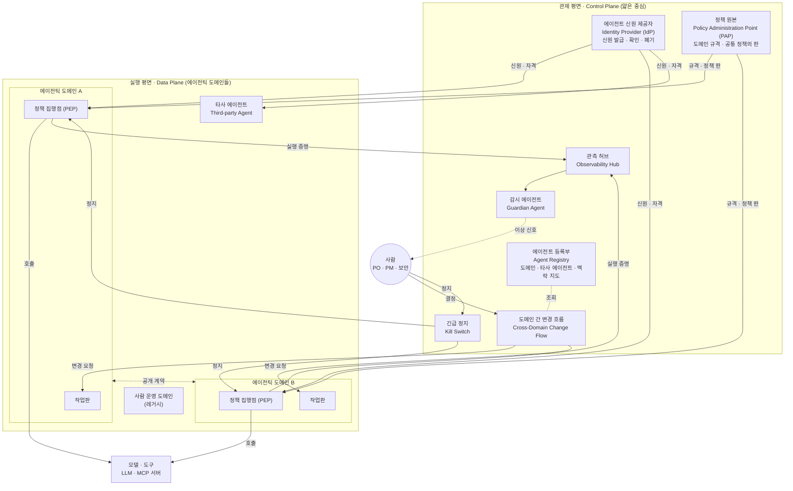
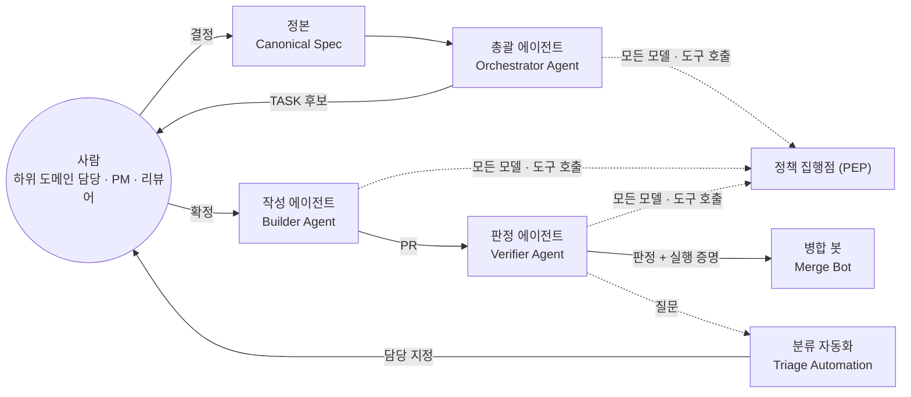

# AI 에이전틱 컨셉추얼 아키텍처
<!-- 배포 전 작업본. 판은 아래 표와 git 이력으로만 관리하고, 개정 기록은 AI_에이전틱_검토로그.md에만 둔다. -->

| 항목 | 내용 |
| :--- | :--- |
| 판 | 초안 5 |
| 층 | C4 1단계(시스템 맥락) · 2단계 일부 |
| 상태 | **확정(구조 층)**: white 서명 2026-11-14 20:47 KST, 서명 대상 b29a58b. 큰 틀을 바꾸려면 white 결정이 다시 필요하다 |
| 아래 문서 | `관제_평면_설계.md`(C4 2단계) · `에이전틱_도메인_설계.md`(C4 3단계) → `실행_연결.md`(C4 4단계) |
| 근거 | white 11-14 토론, DDD 대조([DDD 방법론 저장소] #3), `research/에이전틱_방법론_조사.md` |
| 신뢰 표기 | 조회하지 않은 표준 용어 출처는 (신뢰 3~4·학습 지식) |

## 1. 목적과 범위

- **이름**: 이 체계 전체를 **연합형 에이전틱 운영 모델(Federated Agentic Operating Model, FAOM)**이라 부른다(white 결정 11-14). '운영 모델'은 일하는 방식 · 역할 · 거버넌스 · 구조를 함께 부르는 표준 용어이고, '연합형'은 데이터 메시의 연합 계산 거버넌스에서 왔다. 에이전트끼리 대화하는 망을 뜻하는 '에이전틱 메시'와 운영체제를 뜻하는 '에이전틱 OS'는 쓰지 않는다. 상표용 고유 이름은 따로 정한다.

이 문서는 에이전틱 체계의 **가장 바깥 그림**이다. 무엇이 있고, 각각 무슨 일을 하며, 일이 어떻게 흐르는지만 적는다. 에이전틱 도메인 하나의 안쪽은 `에이전틱_도메인_설계.md`, 실제 연결(워크플로 · 계정 · 설정)은 `실행_연결.md`에서 정한다.

## 2. 한 장 요약

1. 시스템마다 **에이전틱 도메인**이 하나씩 있고, 도메인이 실제 일을 한다(실행 평면).
2. 도메인들은 **도메인 규격**이라는 하나의 프로토콜을 따른다. 중앙이 일일이 시키지 않아도 같은 규칙이 지켜진다. 집행과 검증은 도메인마다 한다. 이 운영 방식은 데이터 메시의 **연합 계산 거버넌스**(Federated Computational Governance)와 같다(신뢰 3·학습 지식).
3. 위에는 **얇은 중심**(관제 평면)만 둔다. 중심이 꼭 맡는 것은 셋이다: 신원의 뿌리, 규격과 정책의 원본, 긴급 정지. 여기에 도메인을 찾게 해 주는 등록부와, 여러 도메인에 걸친 변경의 흐름 조정이 더해진다. 모두 일이 지나가는 길 밖에 있다.
4. AI는 도메인 안에서도 중심에서도 **보조**다. 결정과 책임은 사람이다.

## 3. 원칙

1. **중심은 얇다**: 도메인 하나 안에서 끝나는 일은 위로 올라가지 않는다.
2. **중심은 도메인 안을 직접 고치지 않는다**: 도메인에 일을 내려보내는 길은 그 도메인 작업판의 변경 요청뿐이고, 도메인의 담당자가 확정한다.
3. **도메인끼리는 공개 계약으로만 잇는다**: 에이전트 간 대화(A2A 등)로 잇지 않는다. A2A는 조직 밖 에이전트를 집행점에서 만날 때만 다시 본다.
4. **가드레일은 에이전트 바깥에서 집행한다**: 에이전트에게 지키라고 시키지 않고, 정책 집행점 · 자격 · 격리 환경에서 막는다.
5. **사람이 정하고 AI는 보조한다**: AI는 후보 · 요약 · 이상 신호를 내고, 결정과 책임은 사람이다.

## 4. 아키텍처 그림

### 4-1. 전체 (C4 1단계)

- 실선은 일이 흐르는 길, 점선은 조회 · 알림이다. 모델 · 도구 호출은 정책 집행점에서 바로 나가고 중심을 거치지 않는다.

### 4-2. 에이전틱 도메인 안 (C4 3단계 미리 보기)

## 5. DDD와의 대응

| 에이전틱 | DDD | 예([시범 서비스]) |
| :--- | :--- | :--- |
| 에이전틱 도메인 | 도메인(한 조직 · 시스템이 푸는 업무 전체) | [시범 서비스] 전체 |
| 하위 도메인(핵심규약의 `domains`, 예: SETT) | 하위 도메인(Subdomain) | 정산 |
| 정본의 맥락 · 공개 계약 | 경계 맥락(Bounded Context) · 공개 언어 | C9 · C11 · C12 |
| 도메인 사이 프로토콜 | 맥락 지도의 관계(공개 언어 · 변환 층) | — |

- 에이전틱 도메인 하나 = 시스템 하나 = DDD 도메인 하나. 그 안에 하위 도메인이 여럿이고, 하위 도메인마다 경계 맥락이 하나 이상이다(DDD 대조 11-14, Evans · Vernon 용어, 신뢰 3).
- 글에서는 늘 '에이전틱 도메인'으로 앞말을 붙인다. 맨 '도메인'과 섞지 않는다.
- 경계 맥락은 에이전틱 도메인 둘에 걸치지 않는다.
- 업무가 아니라 기술 묶음(공용 도구 모음 등)인 단위는 에이전틱 도메인이 아니라 **공용 기반**으로 부른다.

## 6. 용어 정의

구분: **표준** = 있는 용어를 그 뜻으로 씀 · **차용** = 있는 용어를 우리 맥락에 맞게 좁혀 씀 · **명명** = 맞는 용어가 없어 새로 지음. 원칙: 있는 용어를 최대한 쓰고, 정말 없고 우리만의 것만 명명한다(white 11-14).

### 6-1. 큰 구분

| 영문 | 약어 | 한글 업무 용어 | 구분 | 정의 |
| :--- | :--- | :--- | :---: | :--- |
| Agentic Domain | — | 에이전틱 도메인 | 차용 | 시스템 하나에 들어가는 실행 단위. 정본 하나 · 작업판 하나 · 앱 저장소 여럿 · 에이전트 다섯 · 정책 집행점. 자기 일을 소유하고 운영한다(데이터 메시의 도메인 소유에서 차용) |
| Subdomain | — | 하위 도메인 | 표준 | 에이전틱 도메인 안의 업무 영역(DDD 용어). 핵심규약의 `domains` 항목과 `domain:` 라벨이 가리키는 것 |
| Shared Foundation | — | 공용 기반 | 차용 | 업무가 아니라 기술 묶음인 단위(공용 도구 모음 등) |
| Data Plane | — | 실행 평면 | 표준 | 실제 일이 일어나는 층. 여기서는 에이전틱 도메인들 |
| Control Plane | — | 관제 평면 | 표준 | 실행 평면을 관리하는 층. 여기서는 얇은 중심 |
| Federated Computational Governance | — | 연합 계산 거버넌스 | 표준 | 공통 규칙을 각 도메인이 코드로 집행하는 운영 방식(데이터 메시 용어) |
| Domain Conformance Spec | — | 도메인 규격 | 명명 | 모든 에이전틱 도메인이 지키는 프로토콜. 지키면 안이 달라도 관제 평면에 붙는다. 여섯 항목(8절) |
| Resource Hierarchy | — | 관리 계층 | 표준 | 누가 비용을 내고 신원 · 정책을 관리하며 무엇을 모아 보는지의 나무. 테넌트 → 조직 → 팀 → 에이전틱 도메인. 업무 계층(에이전틱 도메인 → 하위 도메인 → 경계 맥락)과 다른 축이다(클라우드의 조직 · 폴더 · 프로젝트 계층과 같은 모양, 신뢰 3·학습 지식) |
| Tenant | — | 테넌트(고객사) | 표준 | 관리 계층의 맨 위. 신원 · 비밀값 · 데이터 등급 · 공통 집행 정책을 하나로 가진다 |
| Organization · Team | — | 조직 · 팀 | 표준 | 관리 계층의 중간 칸. 쓰지 않는 칸은 건너뛴다 |
| Policy Inheritance | — | 정책 상속 | 표준 | 위 칸의 정책이 아래로 물려 내려간다. 아래 칸은 더 엄하게만 바꿀 수 있다 |
| Effective Policy | — | 실효 정책 | 표준 | 위 칸들의 정책을 모두 합친 최종 정책. 어느 칸에서든 볼 수 있어야 "왜 막혔나"를 찾는다 |

### 6-2. 관제 평면의 부품

| 영문 | 약어 | 한글 업무 용어 | 구분 | 정의 |
| :--- | :--- | :--- | :---: | :--- |
| Identity Provider | IdP | 에이전트 신원 제공자 | 표준 | 에이전트마다 신원과 짧게 사는 자격을 발급 · 확인하고 폐기한다. 워크로드 신원 표준(SPIFFE) · 인증서 발급처(CA)와 같은 자리(신뢰 3) |
| Trust Anchor | — | 신뢰의 뿌리 | 표준 | 모든 신원 확인이 거슬러 올라가는 출발점. IdP가 갖는다 |
| Policy Administration Point | PAP | 정책 원본 | 표준 | 공통 정책과 도메인 규격의 원본 · 판(NIST SP 800-207 제로 트러스트 용어, 신뢰 4). 이 저장소가 그 원본이다 |
| Agent Registry | — | 에이전트 등록부 | 표준 | 에이전틱 도메인 · 타사 에이전트 · 도구의 목록, 주인, 판, 공개 계약. 조회만 받는다. DNS와 같은 자리 |
| Context Map | — | 맥락 지도 | 표준 | 도메인 사이 관계와 공개 계약을 그린 지도(DDD 용어). 등록부 안에 있다 |
| Kill Switch | — | 긴급 정지 | 표준 | 도메인 · 에이전트 · 신원 단위로 즉시 멈춤. 다시 켜는 것은 그 도메인 책임자(사람)가 하고 기록을 남긴다 |
| Cross-Domain Change Flow | — | 도메인 간 변경 흐름 | 명명 | 여러 에이전틱 도메인에 걸친 변경만 타는 흐름 |
| Change Request | CR | 변경 요청 | 표준 | 변경 하나의 기록 · 승인 단위(ITIL 용어, 신뢰 3). 여러 도메인에 걸친 것은 '도메인 간 변경 요청' |
| Observability Hub | — | 관측 허브 | 차용 | 실행 증명과 집행 기록을 모아 보는 곳. 읽기만 한다 |
| Guardian Agent | — | 감시 에이전트 | 표준 | 다른 AI를 감시하는 AI(Gartner 용어, 신뢰 4). 이상 신호를 사람에게 알린다. 고치거나 멈추지 않는다 |

### 6-3. 에이전틱 도메인의 부품

| 영문 | 약어 | 한글 업무 용어 | 구분 | 정의 |
| :--- | :--- | :--- | :---: | :--- |
| Policy Enforcement Point | PEP | 정책 집행점 | 표준 | 도메인의 모든 모델 · 도구 호출이 지나가며 정책을 집행하는 곳(NIST SP 800-207). 'Agent Gateway'와 같다 |
| Policy Decision Point | PDP | 정책 판단 | 표준 | 호출 하나의 허용 여부 판단. 정책 집행점 안에 있다 |
| System of Record | SoR | 작업판(기록 시스템) | 표준 | 도메인의 상태 원본. 조건 셋: 상태와 기록이 남음 · 상태가 바뀌면 신호 · 확정에 권한. 기준 구현은 GitHub |
| Canonical Spec | — | 정본 | 차용 | 도메인의 업무 규칙 원본(핵심규약 1절) |
| Orchestrator Agent | — | 총괄 에이전트 | 표준 | 변경을 작업 후보로 쪼개고 배정 후보를 붙인다. 확정은 사람 |
| Builder Agent | — | 작성 에이전트 | 차용 | 작업을 맡아 산출물을 만든다. 도메인 안의 유일한 쓰기 주체 |
| Verifier Agent | — | 판정 에이전트 | 표준 | 만든 것을 기준과 대조한다(생성자-검증자 패턴, 신뢰 4). 고치지 않는다 |
| Merge Bot | — | 병합 봇 | 차용 | 관문 수준이 허락할 때 병합만 실행하는 스크립트. AI가 아니다 |
| Triage Automation | — | 분류 자동화 | 표준 | 들어온 질문 · 요청을 분류하고 담당자를 붙인다. AI가 아니다 |
| Gate Autonomy Level | — | 관문 수준 | 차용 | 3 사람 판정 / 2 AI 판정 + 사람 확인(Human-in-the-loop) / 1 AI 판정 통과 · 사후 되돌림(Human-on-the-loop) |
| Provenance Attestation | — | 실행 증명 | 표준 | 실행마다 남기는 서명된 출처 기록(수행자 · 모델 · 지침 판 · 대조 커밋 · 토큰 · 판정). SLSA 출처 증명과 같은 개념(신뢰 3) |

### 6-4. 도메인 사이

| 영문 | 약어 | 한글 업무 용어 | 구분 | 정의 |
| :--- | :--- | :--- | :---: | :--- |
| Published Contract | — | 공개 계약 | 차용 | 도메인이 다른 도메인에 내보이는 API · 이벤트 · 데이터의 약속. 주인은 하나(DDD 공개 언어에서 차용) |
| Consumer-Driven Contract Test | CDC | 소비자 주도 계약 테스트 | 표준 | 받는 쪽이 기대를 테스트로 적고 내보내는 쪽이 통과한다 |
| Expand–Contract | — | 넓히고 좁히기 배포 | 표준 | 옛 · 새 형식을 함께 받는 판을 먼저 내고, 모두 옮긴 뒤 옛 형식을 지운다 |
| Human-operated Domain | — | 사람 운영 도메인 | 명명 | 도메인 규격을 못 채우는 시스템(레거시 · 외부 솔루션). 사람이 상태를 옮기고, 걸린 관문은 수준 3 |
| Third-party Agent | — | 타사 에이전트 | 표준 | 우리가 만들지 않은 에이전트. 등록과 집행점 경유만 지킨다 |
| Lowest Common Ancestor | LCA | 가장 낮은 공통 칸 | 차용 | 도메인 간 변경은 관리 계층에서 걸린 도메인들을 모두 덮는 가장 낮은 칸 하나에서만 처리한다 |

## 7. 부위별 역할

1. **에이전트 신원 제공자(IdP)**: 에이전트에게 신원과 분 단위로 짧게 사는 자격을 준다. 문제가 생기면 갱신을 끊어, 밀어 보내지 않아도 모든 집행점에서 저절로 멈추게 한다. 사람 계정과 섞지 않는다.
2. **정책 원본(PAP)**: 도메인 규격, 공통 정책(허용 모델 · 도구, 데이터 등급, 비용 한도의 상한), 핵심규약 · 스킬의 판을 둔다. 판을 올리면 도메인마다 PR 하나로 내려가고 도메인 담당자가 병합한다. 도메인은 더 엄하게만 바꿀 수 있다.
3. **에이전트 등록부**: 무엇이 있고 누가 주인인지, 어떤 공개 계약으로 이어지는지 답한다.
4. **긴급 정지**: 사람이 도메인 · 에이전트 · 신원 단위로 누른다. 정해진 문턱(비용 한도 등)은 정책 집행점이 기계로 먼저 멈춘다. 다시 켜는 것은 늘 사람이다.
5. **도메인 간 변경 흐름**: 걸친 변경만 탄다. 쪼개기는 AI가 후보를 내고 사람이 판정한다(수준 3 고정). 계약 검사는 기계(소비자 주도 계약 테스트)로 하고, 기계로 못 보는 의미 어긋남만 판정 에이전트가 '목록 밖 발견'으로 사람에게 넘긴다. 배포는 넓히고 → 옮기고 → 좁힌다. 하위 호환 변경은 이 흐름을 타지 않는다.
6. **관측 허브와 감시 에이전트**: 실행 증명 · 집행 기록을 모아 비용 급증 · 판정 뒤집힘 · 실패 반복 · 권한 밖 호출 시도를 찾아 사람에게 알린다. 관문 수준을 올리고 내릴 근거가 된다.
7. **정책 집행점(PEP)**: 모델 · 도구를 부를 때마다 신원 확인 · 정책 판단 · 데이터 등급 차단 · 비용 계산 · 감사 기록을 한다. 도메인마다 있어서 중심 하나가 멈춰도 다른 도메인은 돈다.

## 8. 도메인 규격 여섯 항목

| # | 항목 | 왜 필요한가 |
| :---: | :--- | :--- |
| 1 | 등록부에 한 줄(이름 · 시스템 · 주인 · 작업판 · 규격 판 · 켠 선택 항목) | 찾을 수 있어야 이을 수 있다 |
| 2 | 작업판 세 조건 | 상태로 돌기 위해 |
| 3 | 실행 증명 형식(시범 기간에는 실행 링크로 출처 확인, 서명은 정책 집행점과 함께) | 중심에 묻지 않고 서로 확인하기 위해 |
| 4 | 모든 모델 · 도구 호출은 정책 집행점으로, 신원은 IdP에서(집행점 전 시범 기간에는 도메인마다 키 + 비용 한도) | 가드레일을 에이전트 바깥에서 집행하기 위해 |
| 5 | 공개 계약과 받는 쪽 계약 테스트 | 도메인 사이 검사를 기계로 하기 위해 |
| 6 | 관문 수준 · 위험 등급 A 설정 형식 | 도메인마다 다른 수준을 같은 눈으로 보기 위해 |

- 규격을 못 채우는 시스템은 사람 운영 도메인으로, 우리가 만들지 않은 에이전트는 타사 에이전트로 등록한다(타사 에이전트는 항목 1 · 4만).
- **정본만 있는 도메인**: 앱 코드를 바꿀 수 없는 시스템(산 SaaS를 설정해서 씀 등)은 앱 저장소 대신 설정 · 연동 기록을 작업판에 두고, 에이전트는 정본과 설정 기록만 쓴다. 규격 1 ~ 6은 그대로 지킨다. 사람 운영 도메인과의 경계는 'AI가 쓰는 산출물이 정본 · 설정 기록뿐이고 작업판 세 조건을 채우는가'다(DDD 대조 11-15, DDD 짝: G2의 바꿀 수 없는 구현 꼴).

## 9. 흐름 넷

1. **도메인 안의 일(대부분)**: 정본 결정 → 총괄의 작업 후보 → 사람 확정 → 작성 → 판정 → 관문 수준대로 병합. 관제 평면에 올라가지 않는다. 모델 호출만 정책 집행점을 지나며 실행 증명이 관측 허브로 간다.
2. **도메인 간 변경(드묾)**: 사람이 도메인 간 변경 요청을 연다 → 등록부로 걸린 도메인을 찾고 가장 낮은 공통 칸에서 처리 → 쪼개기 후보 → 사람 판정 → 도메인마다 변경 요청 → 각 도메인 흐름 → 계약 테스트 → 넓히고 좁히기 배포. 수준은 묶인 도메인 가운데 가장 높은 것.
3. **감시와 정지**: 실행 증명 · 집행 기록 → 관측 허브 → 감시 에이전트의 이상 신호 → 사람이 판단 → 필요하면 긴급 정지.
4. **규격 판 올림**: 정책 원본에서 판을 올림 → 도메인마다 PR → 도메인 담당자 병합 → 등록부의 그 도메인 줄에 규격 판 갱신.

## 10. 넓히기

1. **도메인 안**: 사안에 따라 싱글 → 멀티(`에이전틱_도메인_설계.md` 4절).
2. **도메인 수**: 시스템이 늘면 에이전틱 도메인을 하나 더 붙인다. 새 도메인의 처음 관문 수준은 3이다.
3. **관리 계층(엔터프라이즈 · 서비스화)**: 큰 회사가 여러 에이전틱 도메인을 묶어 관제할 수 있게, 관리 계층을 테넌트(고객사) → 조직(사업부) → 팀 → 에이전틱 도메인으로 둔다(white 11-14). 클라우드의 조직 · 폴더 · 프로젝트, GitHub의 엔터프라이즈 · 조직 · 팀과 같은 모양이다(신뢰 3~4·학습 지식).
   - **업무 계층과 나눈다**: 에이전틱 도메인은 관리 계층의 한 칸(보통 팀)에 소속만 된다. 팀 하나가 도메인 여럿을 가질 수 있다. 팀이 바뀌어도 도메인의 업무 경계(DDD)는 바뀌지 않는다.
   - **중간 칸은 실행 부품이 아니다**: 칸마다 갖는 것은 정책, 등록부 보기, 관측 요약, 긴급 정지 범위뿐이다. 집행은 맨 아래 정책 집행점이 위 칸들의 정책을 합쳐서 한다. 칸이 늘어도 일이 지나가는 길은 늘지 않는다.
   - **정책 상속**: 신원 · 비밀값 · 데이터 등급 · 공통 집행 정책은 테넌트에 하나로 두고 아래로 물려준다. 아래 칸은 더 엄하게만 정한다. 어느 칸에서든 실효 정책을 볼 수 있어야 한다.
   - **관문 수준의 바닥**: 관문 수준은 도메인의 사람이 정한다. 위 칸은 수준의 바닥만 정할 수 있고, 도메인은 그보다 낮출 수 없다. 바닥을 정한 칸의 책임자 이름을 기록하고, 도메인 역할표에 '수준 바닥 = 어느 칸 정책'을 적는다("왜 수준 1로 못 내리나"를 찾기 위해).
   - **도메인 간 변경**: 걸린 도메인들을 모두 덮는 가장 낮은 칸(LCA)이 변경을 열고 정책을 합친다. 같은 팀 안이면 팀에서, 두 조직에 걸치면 테넌트에서. 업무 해석 · 선택은 LCA 칸이 아니라 걸린 도메인들의 결정자(PO)가 근거 순서(법 > 계약 > PO 결정 > 정본)대로 정한다.
   - **관리 칸은 업무 결정을 가져가지 않는다**: 위험 수용 서명은 도메인 결정자(PO) 자리에 그대로 있고, 테넌트 · 조직 관리자는 서명자가 아니다. 긴급 정지 범위는 칸마다 둘 수 있지만 다시 켜기는 그 도메인 책임자가 한다.
   - **쓰지 않는 칸은 건너뛴다**: 작은 회사는 테넌트 → 에이전틱 도메인만으로 쓴다.
   - **상품 쪽 자리(방법론 밖)**: 고객사 신원 체계(SSO) 연동, 감사 기록 내보내기, 데이터 보관 지역, 테넌트 사이 격리. 엔터프라이즈 상품 설계에서 정한다.
4. **1000개 이상일 때의 보강(메모, 구조 층 서명 뒤 확정)**: ① 규격 판 호환 창(최근 두세 판, 단 관문 규칙은 늘 현재 판) ② 짧게 사는 자격 + 갱신 중단으로 정지, 다시 켜기는 사람 ③ 결정적 적합성 시험을 통과해야 등록 ④ 관리 계층 칸별 관측 요약(원기록은 지우지 않고, 사람 표본 검토는 원기록에서). 실제 한계는 조직 구조(콘웨이 법칙)다.

## 11. 줌인 단계 (C4 모델)

| 단계 | C4 이름 | 이 체계에서 | 문서 |
| :---: | :--- | :--- | :--- |
| 1 | 시스템 맥락 | 4-1 그림 | 이 문서 |
| 2 | 컨테이너 | 관제 평면 부품과 정책 집행점 · 작업판 각각의 책임 · 주고받는 것 · 저장 위치, 관리 계층의 칸 · 역할 · 정책 상속 | `관제_평면_설계.md`, `관리_계층_설계.md` |
| 3 | 구성 요소 | 에이전틱 도메인 안 에이전트 다섯 · 정책 집행점 · 판정 흐름 | `에이전틱_도메인_설계.md` |
| 4 | 코드 | 워크플로 · 설정 · 스크립트 · 스킬 | `실행_연결.md`, 설치서, `skills/` |

C4 모델은 소프트웨어 아키텍처를 네 단계 확대로 그리는 방식이다(신뢰 3·학습 지식).

## 12. 남은 결정

1. ~~(white) 구조 층 서명~~ → 서명됨(11-14 20:47 KST, b29a58b).
2. **(진행 중)** C4 2단계는 `관제_평면_설계.md`.
3. **(도메인 시범 뒤)** 정책 집행점 · 신원 제공자 · 관측 허브를 업체 제품으로 쓸지 만들지.
