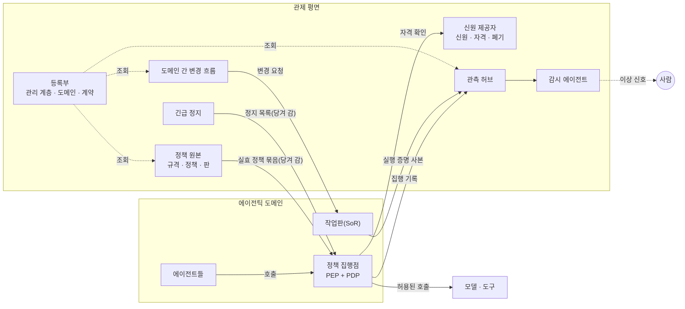

# AI 에이전틱 관제 평면 설계
<!-- 배포 전 작업본. 판은 아래 표와 git 이력으로만 관리하고, 개정 기록은 AI_에이전틱_검토로그.md에만 둔다. -->

| 항목 | 내용 |
| :--- | :--- |
| 판 | 초안 1 |
| 층 | C4 2단계(컨테이너): 관제 평면 부품과 정책 집행점 · 작업판 |
| 상태 | 초안(구조 층 서명 11-14 뒤의 아래 층, DDD 대조 뒤 확정) |
| 위 문서 | `개념_아키텍처.md` |
| 옆 문서 | `에이전틱_도메인_설계.md`(도메인 안, C4 3단계) |
| 아래 문서 | `실행_연결.md`(C4 4단계) |

## 1. 목적과 범위

- **목적**: 개념 아키텍처의 부품마다 무엇을 책임지고, 무엇을 받고 내보내며, 어디에 저장하고, 멈추면 무엇이 되는지를 정한다.
- **범위**: 관제 평면 부품 일곱, 정책 집행점, 작업판, 관리 계층의 자료. 제품 선택(사서 쓸지 만들지)은 하지 않고, 부품마다 시범 기간의 대체물만 적는다.
- **원칙(개념 아키텍처 3절)**: 중심은 얇고 일의 길 밖에 있다. 집행은 정책 집행점에서 한다. 관리 칸은 업무 결정을 가져가지 않는다.

## 2. 그림 (C4 2단계)



- 집행점은 정책과 정지 목록을 **당겨 간다**(밀어 넣지 않음). 중심이 멈춰도 집행점은 마지막으로 받은 정책으로 돌고, 자격은 짧게 살아 저절로 끊긴다.

## 3. 부품별 명세

| 부품 | 책임 | 받는 것 | 내보내는 것 | 저장(원본) | 멈추면 | 시범 기간 대체물 |
| :--- | :--- | :--- | :--- | :--- | :--- | :--- |
| 신원 제공자(IdP) | 에이전트 신원 발급, 짧게 사는 자격(분 단위), 폐기 | 등록부의 에이전트 목록, 사람의 폐기 | 자격, 공개 키 | 신원 목록 · 폐기 목록 | 새 자격이 안 나와 몇 분 안에 모든 에이전트가 멈춘다(안전 쪽으로 멈춤) | GitHub App 셋(역할별), 설치 토큰(짧게 삶) |
| 정책 원본(PAP) | 도메인 규격 · 공통 정책 · 핵심규약 · 스킬의 판, 칸별 정책, 실효 정책 계산 | 판 올림 PR(사람 승인) | 도메인별 실효 정책 묶음(판 번호 붙음) | 규약 원본 저장소 + 칸별 정책 파일 | 집행점은 마지막 묶음으로 계속 돈다. 판 올림만 멈춘다 | 이 저장소 + 도메인의 `agentic-env.yaml` |
| 등록부 | 관리 계층(테넌트 · 조직 · 팀), 칸별 도메인 · 타사 에이전트 · 도구, 공개 계약과 주인, 맥락 지도 | 등록 · 해지 PR(사람 승인), 적합성 시험 결과 | 조회 응답 | 등록부 저장소(파일) | 조회만 멈춘다. 도메인 안의 일은 계속 돈다 | 도메인 하나뿐이라 두지 않음 |
| 긴급 정지 | 칸 · 도메인 · 에이전트 · 신원 단위 정지 목록 | 사람의 정지 · 다시 켜기(도메인 책임자) | 정지 목록 | 정지 목록 + 기록 | 정지 목록을 못 당기면 집행점은 마지막 목록을 쓴다. 자격이 짧게 살아 IdP 폐기로도 멈출 수 있다 | `agents.enabled: false` PR |
| 도메인 간 변경 흐름 | 걸친 변경 요청 열기 · 쪼개기 후보 · 선후 걸기 · 계약 테스트 확인 | 사람의 변경 요청, 등록부 조회 | 도메인별 변경 요청, 배포 순서 | 상위 작업판(변경 요청 기록) | 걸친 변경만 멈춘다 | 도메인 하나뿐이라 두지 않음 |
| 관측 허브 | 집행 기록 · 실행 증명 모으기, 칸별 요약, 원기록 보존 | 집행 기록, 실행 증명 사본 | 칸별 요약, 원기록 조회 | 원기록 저장소(지우지 않음) | 기록이 집행점 쪽에 쌓였다가 다시 보낸다 | PR 코멘트의 실행 기록 줄을 주간 회의에서 봄 |
| 감시 에이전트 | 이상 신호 찾기(비용 급증 · 판정 뒤집힘 · 실패 반복 · 권한 밖 호출 시도) | 관측 허브 원기록 | 사람에게 알림 | 알림 기록 | 알림만 멈춘다. 집행점의 문턱 정지는 그대로 | 사람이 주간 회의에서 봄 |
| 정책 집행점(PEP + PDP) | 호출마다 자격 확인 · 정책 판단 · 데이터 등급 차단 · 비용 계산 · 감사 기록, 문턱 넘으면 정지 | 에이전트의 호출, 실효 정책 묶음, 정지 목록 | 허용된 호출, 집행 기록 | 집행 기록(보내기 전 임시) | 그 도메인의 에이전트 호출이 모두 막힌다(안전 쪽으로 멈춤) | 실행당 토큰 상한 + 역할별 App 권한 |
| 작업판(SoR) | 도메인의 상태 원본 | 에이전트 · 사람의 PR · Issue | 상태 변화 신호 | 도메인 저장소 | 그 도메인 일이 멈춘다 | GitHub |

## 4. 관리 계층 자료 (등록부 안)

```yaml
# 등록부 한 칸의 모양(자리표시자). 실제 형식은 실행 연결 층에서 정한다.
tenant: <테넌트>
  policy_ref: <정책 원본의 칸 정책 판>
  orgs:
    - org: <조직>
      teams:
        - team: <팀>
          gate_floor: {code_merge: 2}        # 수준 바닥(선택). 정한 사람 이름을 기록
          gate_floor_owner: <책임자 역할>
          domains:
            - domain: <에이전틱 도메인>
              owner: <도메인 결정자 역할>
              sor: <작업판 위치>
              spec_version: <도메인 규격 판>
              conformance: pass@<시험 판>
              published_contracts: [<계약 이름>]
```

- 사람 이름 대신 역할을 적고, 사람과 역할의 대응은 신원 제공자에 둔다.
- 쓰지 않는 칸(조직 · 팀)은 빼고 적는다.

## 5. 신뢰 경계

1. **에이전트 ↔ 정책 집행점**: 에이전트는 믿지 않는다. 모든 호출은 집행점에서 자격과 정책으로 판단한다.
2. **정책 집행점 ↔ 관제 평면**: 집행점은 정책 원본과 정지 목록의 서명(판 번호 + 원본 서명)을 확인한 뒤에만 쓴다(서명 방식은 실행 연결 층에서).
3. **도메인 ↔ 도메인**: 공개 계약과 실행 증명으로만 믿는다. 상대 도메인의 내부를 읽지 않는다.
4. **테넌트 ↔ 테넌트**: 신원 · 정책 · 기록을 나눈다(상품 쪽 일, 개념 아키텍처 10-3).

## 6. 남은 결정

1. **(DDD 대조 뒤)** 이 문서 확정.
2. **(도메인이 둘이 될 때)** 등록부 · 도메인 간 변경 흐름을 켠다.
3. **(시범 뒤)** 집행점 · 신원 제공자 · 관측 허브를 업체 제품으로 쓸지 만들지, 정책 묶음의 서명 방식.
