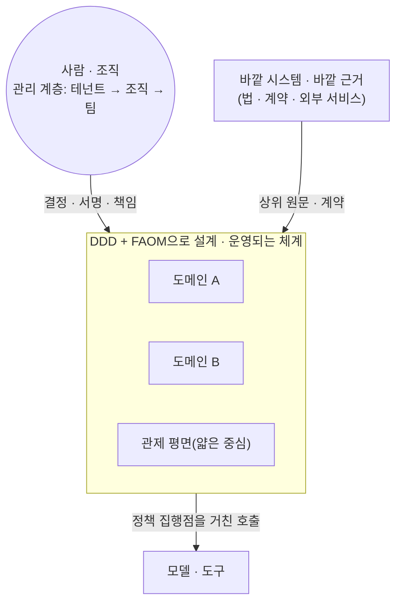

# DDD + FAOM 통합 아키텍처 (C4 1 · 2단계, 뼈대)
<!-- 배포 전 작업본. 통합 원본 자리(목표 재판단 회의 5-2 4)가 정해지면 그리로 옮긴다. 이 저장소는 공개라 DDD 칸은 DDD가 비공개 원본 자리에서 채운다. 판은 git 이력으로만. -->

| 항목 | 내용 |
| :--- | :--- |
| 판 | 뼈대 1 |
| 층 | C4 1단계(시스템 맥락) · 2단계(컨테이너) |
| 상태 | 에이전틱 엮음 초안. FAOM 칸만 채움, DDD 칸은 DDD가 채움 |
| 계기 | white 11-15 20:16 KST: DDD 방법론과 FAOM은 하나의 담론 · 방법론 · 아키텍처, C4로 함께 설계, [시범 서비스]는 증명 재료 |
| 공동 할 일 | 목표 재판단 회의 J1(이 문서) · J2(통합 용어표) · J3(도메인 꽂는 절차) |

## 1. 목적과 범위

- **목적**: DDD(무엇을 어떤 경계 · 단계 · 관문으로 설계하나)와 FAOM(그 일을 AI와 사람이 어떤 평면 · 역할 · 관문 · 기록으로 나눠 하나)을 한 그림에 겹쳐, 어느 도메인을 꽂아도 같은 틀로 돌게 한다.
- **범위**: C4 1 · 2단계. 칸마다 'DDD가 정하는 것 / FAOM이 정하는 것 / 원본 문서'를 적는다. 3 · 4단계는 두 방법론의 각 문서를 가리킨다.
- **합격 기준**: 도메인 이름이 하나도 들어가지 않는다. 도메인 고유인 것은 증명 기록에만 둔다.

## 2. C4 1단계: 시스템 맥락

| 칸 | DDD가 정하는 것 | FAOM이 정하는 것 | 원본 문서 |
| :--- | :--- | :--- | :--- |
| 사람 · 조직 | (DDD 채움: 결정자 · 판정자 · 반대 검토의 역할표, 근거 순서) | 관리 계층(테넌트 → 조직 → 팀 → 에이전틱 도메인), 칸마다 정할 수 있는 것, 서명은 도메인 결정자 | FAOM: `관리_계층_설계.md` / DDD: (채움) |
| 도메인 | (DDD 채움: 도메인 · 하위 도메인 · 경계 맥락을 나누는 법, 단계 N0 ~ N5) | 에이전틱 도메인 = 시스템 하나 = 작업판 하나, 도메인 규격 여섯 | FAOM: `개념_아키텍처.md` 5 · 8절 / DDD: (채움) |
| 관제 평면 | (DDD 채움: 관문 G0 ~ G2 · 기준선 · R2 · 릴리즈의 규칙과 수준) | 신원 제공자 · 정책 원본 · 등록부 · 긴급 정지 · 관측 · 감시 에이전트, 중심은 얇게 | FAOM: `관제_평면_설계.md` / DDD: (채움) |
| 바깥 근거 | (DDD 채움: 근거 종류 확인 · 해석 · 선택, 근거 순서 법 > 계약 > 결정 > 정본) | 판정 입력에 상위 원문을 반드시 넣음, 실데이터 · 개인정보는 에이전트 입력 금지 | FAOM: `에이전틱_도메인_설계.md` 5 · 9절 / DDD: (채움) |
| 모델 · 도구 | — | 정책 집행점을 거쳐서만, 실행 증명 남김 | FAOM: `관제_평면_설계.md` 6-1 |

## 3. C4 2단계: 컨테이너

| 컨테이너 | 하는 일 | DDD가 정하는 것 | FAOM이 정하는 것 | 원본 문서 |
| :--- | :--- | :--- | :--- | :--- |
| 작업 공간 홈 | 에이전트 세션이 출발하는 자리. 공통 지침 · 스킬 · 저장소 포인터 표 | (DDD 채움: 짧은 전역 진입점 · 저장소 구역) | 테넌트 칸 정책 원본 + 등록부(포인터 표). 줄마다 쓰기 가능 여부 · 어디서 되나 | FAOM: `실행_연결.md` 9절 / 홈 회의 |
| 도메인 저장소(작업판) | 도메인의 상태 원본: 정본 · 작업 지시서 · 질문 · 코드 | (DDD 채움: 정본의 산출물 꼴 — 정의서 · 불변식 · 정책서 · 결정 기록) | 작업판 세 조건, 에이전트 다섯이 상태로만 일함 | FAOM: `에이전틱_도메인_설계.md` 2 · 5절 / DDD: (채움) |
| 판정 관문 장치 | 사람 · 판정 에이전트가 기준으로 판정 | (DDD 채움: 판정 3분류, 수행자 독립 조건, 판정 기준 내용) | 관문 수준 1 ~ 3, 검사 넷, 판정 기준의 꼴(읽는 폭 · 기계 몫), 그림자 판정 | FAOM: `판정_기준_작성법.md`, `실행_연결.md` 7절 / DDD: (채움) |
| 자동 관문 장치 | 결정적 검사 | (DDD 채움: 자동 관문은 결정적만) | `check`, 정책 합침 · 기록 줄 검사 | FAOM: `실행_연결.md` 10절, `tools/` |
| 관제 평면 부품 | 신원 · 정책 · 등록부 · 정지 · 관측 · 감시 | — | 부품별 책임 · 멈추면 · 시범 대체물 | FAOM: `관제_평면_설계.md` |
| 정책 집행점 | 모든 모델 · 도구 호출의 집행 | — | 자격 · 정책 판단 · 데이터 등급 · 비용 · 기록 | FAOM: `관제_평면_설계.md` 6-1 |

## 4. 남은 것

1. **(DDD)** 각 칸의 DDD 쪽 채우기. 비공개 원본 자리에서 채우고, 통합 자리가 정해지면 이 문서와 합친다.
2. **(J2)** 칸에 나오는 두 방법론의 낱말을 통합 용어표로.
3. **(J3)** 이 그림대로 도메인 하나를 꽂는 절차. 시험은 [시범 서비스] 다시 꽂기와 종이 위 두 번째 도메인.
4. **(PO)** 통합 원본 자리.
